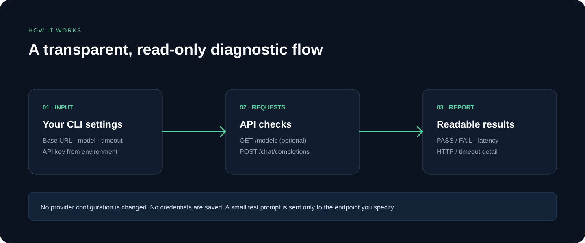
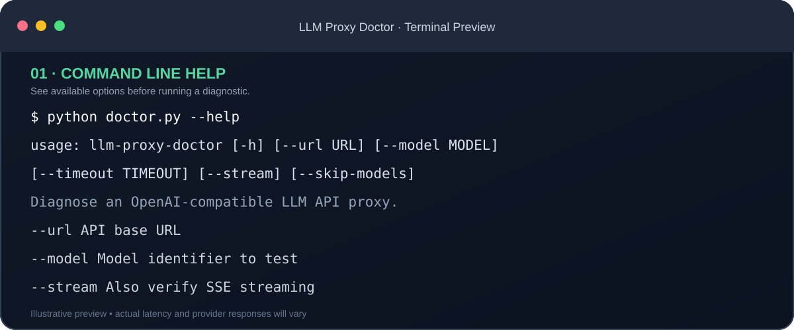
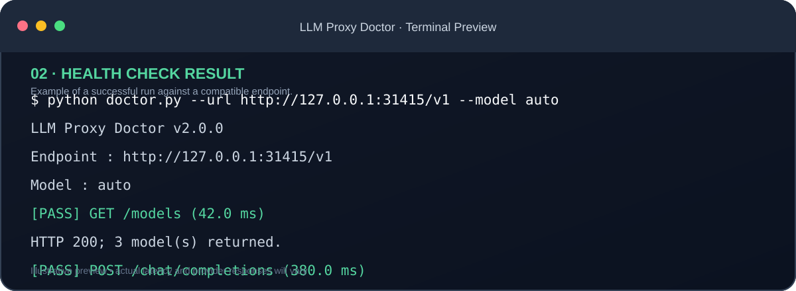
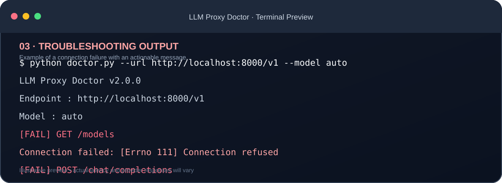
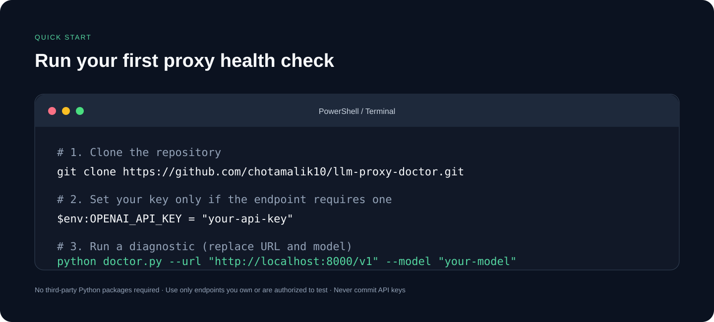

# 🩺 LLM Proxy Doctor

**A lightweight, dependency-free diagnostic CLI for OpenAI-compatible LLM gateways.**

Check connectivity, authentication, model discovery, response structure, latency, and optional SSE streaming — from one command.

---

## Why this project?

An LLM proxy can be reachable while still rejecting credentials, hiding model discovery, returning malformed JSON, or failing on streaming requests. LLM Proxy Doctor runs practical checks against an OpenAI-compatible API and reports what passed or failed.

## How it works

## Features

- Connectivity and per-request latency measurement.
- API key support through environment variables.
- GET /models response validation.
- POST /chat/completions request and response validation.
- Optional Server-Sent Events (SSE) streaming check.
- Actionable HTTP, connection, and timeout errors.
- No third-party Python dependencies.
- No API key passed as a command-line argument.

## Terminal previews

These are illustrative previews of the CLI output. Real response times, model counts, and error messages depend on your configured provider.

### Command help

### Successful diagnostic

### Connection error example

## Requirements

- Python 3.9 or newer.
- An OpenAI-compatible API endpoint.
- An API key only if your provider requires authentication.

## Quick start

Clone the repository:

~~~bash
git clone https://github.com/chotamalik10/llm-proxy-doctor.git
cd llm-proxy-doctor
~~~

### Windows PowerShell

~~~powershell
$env:OPENAI_API_KEY = "your-api-key"
python doctor.py --url "http://localhost:8000/v1" --model "your-model"
~~~

### macOS / Linux

~~~bash
export OPENAI_API_KEY="your-api-key"
python3 doctor.py --url "http://localhost:8000/v1" --model "your-model"
~~~

If your proxy does not require authentication, leave the environment variable unset. Never commit real API keys.

## Usage

~~~bash
python doctor.py --help
~~~

| Option | Default | Description |
|---|---|---|
| --url | http://localhost:8000/v1 | API base URL |
| --model | gpt-4o-mini | Model identifier to test |
| --timeout | 15 | Timeout per request, in seconds |
| --stream | Off | Verify SSE streaming |
| --skip-models | Off | Skip GET /models discovery |

Examples:

~~~bash
python doctor.py --url "http://127.0.0.1:31415/v1" --model "auto"
python doctor.py --url "https://api.example.com/v1" --model "my-model" --skip-models
python doctor.py --url "http://localhost:8000/v1" --model "my-model" --stream
~~~

## What is checked?

1. **GET /models** — expects a JSON object with a data array. Some providers disable this endpoint; use --skip-models when expected.
2. **POST /chat/completions** — expects the standard choices[0].message.content response structure.
3. **Streaming (optional)** — checks for SSE data events and the terminal [DONE] marker.

A target model missing from /models is reported as a note, not an automatic failure, because some gateways accept aliases that are not listed.

## Exit codes

- 0 — all enabled checks passed.
- 1 — one or more checks failed.
- 2 — invalid command-line arguments.

## Run tests

~~~bash
python -m unittest discover -s tests -v
~~~

## Security

- Keep API keys in environment variables; never commit secrets.
- Use HTTPS for remote endpoints.
- The tool does not store credentials or telemetry.
- A small test prompt is sent to the endpoint you configure.
- Avoid sharing diagnostic output if error bodies contain sensitive data.

See [Troubleshooting](docs/TROUBLESHOOTING.md), [Contributing](CONTRIBUTING.md), [Security Policy](SECURITY.md), and [MIT License](LICENSE).

## Scope and limitations

This is a diagnostic CLI, not a hosted dashboard, automatic failover controller, or proxy server. It does not modify provider configuration or route production traffic. Checks target the OpenAI-compatible API shape and may need adaptation for provider-specific extensions.

## Contributing

Bug reports and focused pull requests are welcome. Include your Python version, command used with secrets removed, and sanitized error output.

## License

MIT. See LICENSE.
